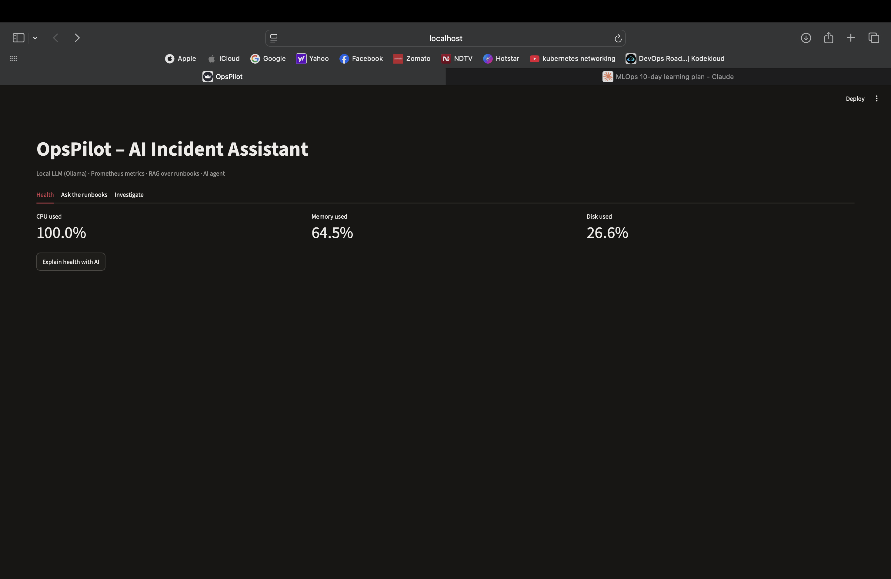

# OpsPilot

A small AI helper I built to make incident checks faster on Linux servers.

I work in production operations. During an incident I usually check dashboards,
read logs, find the right runbook and then write a summary. I wanted to see how
much of that a local AI model could help with.

Everything runs on my laptop. No logs or metrics are sent to the internet.

## What it does

- Shows CPU, memory and disk usage and explains if the server is healthy
- Answers questions using our runbooks, and says "Not found" if the runbook doesn't cover it
- Investigates an alert on its own: checks health, looks up the runbook, runs safe commands
- Summarises SSH and Linux logs

## How it fits together

```text
Server metrics → Prometheus ─┐
Runbooks → ChromaDB ─────────┼─→ Python + local AI (Ollama) → Web page
Log files ───────────────────┘
```

## What I learnt

- The AI can get numbers wrong (it once said 55.7% was above 70%),
  so the code makes the decisions and the AI only explains them.
- Searching by meaning works well: "server is out of space" finds the disk-full runbook.
- The AI agent sometimes repeated the same step, so I added a step limit
  and only allowed safe, read-only commands.

## Screenshots




## Built with

Python, Ollama (Llama 3.2), ChromaDB, Prometheus, Grafana, Streamlit

## Run it

1. Install Ollama and pull `llama3.2` and `nomic-embed-text`
2. `pip install -r requirements.txt`
3. `python src/rag.py` to load the runbooks
4. `streamlit run src/app.py`